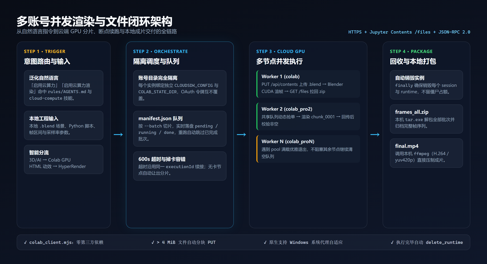
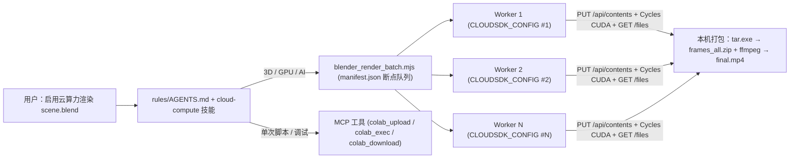
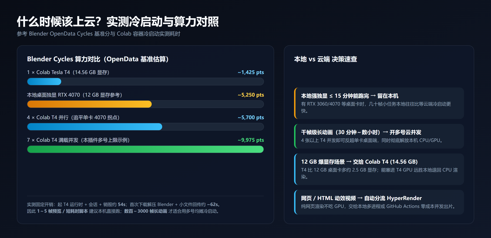

<div align="center">

# agy-colab-plugin — Antigravity × Google Colab 云端算力插件

[](plugin.json)
[](tools/colab-mcp-server.mjs)
[](tools/colab_client.mjs)
[](#license)

**把 Google 官方 Colab MCP 接进 Antigravity：多账号隔离并发 · 二进制文件传取 · Blender Cycles 千帧断点续跑与本地打包 · 自然语言自动触发**

<br/>


</div>

---

## ✨ 核心特性

- **9 个原生 MCP 工具（零第三方 Node 依赖）**：不仅能起停 GPU/CPU 运行时、执行 Python/本地脚本，还通过 Colab `connectionInfo` 通道补齐了 **二进制分片上传**（`> 4 MiB` 自动分块）与 **流式下载**。
- **多账号隔离与并发调度**：通过 `CLOUDSDK_CONFIG` + `COLAB_STATE_DIR` 彻底隔离多个 Google 账号的 OAuth 凭证与运行时状态，互不覆盖、互不串号。
- **千帧级 Blender Cycles 闭环管线**：自带 `blender_render_batch.mjs` 并发调度器——自动上传 `.blend`、共享队列动态抢单、`manifest.json` 断点续跑、600s 超时自动续接、掉卡让渡分片，结束后本机自动打包 `frames_all.zip` 与 `final.mp4`。
- **泛化自然语言自动触发**：内置 `rules/AGENTS.md` 与 `skills/cloud-compute/SKILL.md`，直接对 Agent 说 **「启用云算力」「启用云算力渲染」** 即可自动识别任务并开跑（网页动效任务可联动分流至 `hyperrender`）。
- **自带 AI 多媒体 Notebook / Cell 工具箱**：附带 Wan2.1 文生视频、MusicGen 配乐、Edge-TTS 中文配音字幕、Faster-Whisper 语音转写及 Blender 冒烟模板。

---

## 🏗️ 多账号并发与文件闭环架构





---

## 🛠️ 提供的 9 个 MCP 工具

| 工具名 | 作用 | 典型用途 |
| :--- | :--- | :--- |
| `colab_specs` | 查询当前账号可用机型与资格 | 核验 `T4` / `L4` / `A100` / `TPU` / `CPU` 是否 `eligible` |
| `colab_subscription` | 查询订阅档位 | 查看 `free` / `pro` / `pro+` |
| `colab_ensure_runtime` | 创建或复用 25 分钟内保留运行时 | 先锁机器再分步上传、多轮执行、下载 |
| `colab_exec` | 在云端执行 Python 代码 | 跑 GPU 探测、PyTorch 推理、临时计算 |
| `colab_run_script` | 读取本地 `.py` 文件提交执行 | 跑 `tools/blender_job.py` 等完整脚本 |
| `colab_upload` | 上传本地文件到云端容器 | 传 `.blend`、数据集、压缩包（`> 4 MiB` 自动分片） |
| `colab_download` | 从云端容器拉回产物到本地 | 流式下载 `.zip`、`.mp4`、`.png`、`csv` |
| `colab_list` | 列出运行中的 runtime | 巡检各账号是否有残留占额实例 |
| `colab_delete` | 按名称销毁指定 runtime | 释放会话、文件与配额 |

---

## 🚀 快速安装与配置

### 1. 前置准备（Google Cloud 一次性授权）
确保本机已安装 **Node.js 20+**、**Google Cloud SDK (`gcloud`)**，并按 [AGENT.md](AGENT.md) 完成一次 OAuth 授权与项目启用：

```powershell
# 1) 浏览器授权（必须带 colaboratory scope）
gcloud auth application-default login --launch-browser `
  --scopes="https://www.googleapis.com/auth/colaboratory,https://www.googleapis.com/auth/cloud-platform,openid,https://www.googleapis.com/auth/userinfo.email"

# 2) 新建或使用已有 GCP 项目并启用 Colab MCP API
gcloud projects create <YOUR_PROJECT_ID> --name="colabkit"
gcloud services enable colaboratory.googleapis.com --project=<YOUR_PROJECT_ID>
gcloud auth application-default set-quota-project <YOUR_PROJECT_ID>
gcloud projects add-iam-policy-binding <YOUR_PROJECT_ID> `
  --member="user:<YOUR_EMAIL>" --role="roles/serviceusage.serviceUsageConsumer"
```

### 2. 一键安装到 Antigravity

```powershell
git clone https://github.com/holoiallo/agy-colab-plugin.git
cd agy-colab-plugin
.\install.ps1 -ProjectId <YOUR_PROJECT_ID>
```

安装脚本会自动把 `plugin.json`、`assets/`、`rules/`、`skills/` 与 `tools/` 安装到 `%USERPROFILE%\.gemini\config\plugins\colab`，并生成对应的 `mcp_config.json`（若已有 `mcp_config.json` 默认跳过不覆盖）。随后**重启 Antigravity** 即可生效。

### 3. 添加多个独立账号（可选）

每个新增账号只需运行一次引导脚本，在弹出的浏览器页面完成授权即可（会自动隔离在 `%USERPROFILE%\.gcloud-<ProfileName>` 并注册为 `colab_<ProfileName>`）：

```powershell
& "$env:USERPROFILE\.gemini\config\plugins\colab\tools\add-account.ps1" -ProfileName pro2
& "$env:USERPROFILE\.gemini\config\plugins\colab\tools\add-account.ps1" -ProfileName pro3
```

---

## 🎬 使用示例

### 方式一：在 Antigravity 中直接用自然语言触发
重启 Antigravity 后，直接发送以下任意泛化指令即可：
- **「启用云算力，检查所有节点 T4 资格」**
- **「启用云算力渲染 `D:\projects\hero.blend`，第 1 到 3000 帧，最后在本地打包」**
- **「用 `colab` 上传我的数据集并跑完推理脚本把结果拉回本地」**

### 方式二：命令行直接启动多账号千帧渲染（含断点续跑）

```powershell
# 启动多号并发渲染 + 本地打包 frames_all.zip 与 final.mp4
node tools/blender_render_batch.mjs `
  --blend "D:\path\to\scene.blend" `
  --start 1 --end 3000 --batch 25 --fps 24 --spec gpu_t4 --out ".\out-3000"

# 若中途中断，使用相同 --out 目录重跑即可自动跳过已完成批次
node tools/blender_render_batch.mjs `
  --blend "D:\path\to\scene.blend" --start 1 --end 3000 --batch 25 --out ".\out-3000"

# 无 .blend 文件时跑内置程序化冒烟测试
node tools/blender_render_batch.mjs --smoke --start 1 --end 4 --batch 2 --spec cpu --out ".\out-smoke"
```

> 底层自测（单实例 MCP 握手 + 规格 + 执行）：
> ```powershell
> $env:COLAB_PROJECT = "<YOUR_PROJECT_ID>"
> node tools/colab-mcp-selftest.mjs tools/colab-mcp-server.mjs
> ```

---

## 📊 什么时候该上云？实测冷启动与算力对照



> 注：Colab 免费档及部分订阅账号的 T4 资源池受动态配额约束，高峰期若个别节点暂时返回无卡，多号调度器会自动把分片让渡给其余在线节点完成。

---

## 🧰 附带 AI / 渲染 Notebook 资产（`cells/` & `notebooks/`）

仓库同时保留了完整的 Colab Notebook 驱动资产（源码在 `cells/*.py`，改完后可用 `node tools/build_notebooks.mjs` 重新生成 `notebooks/*.ipynb`）：

| 模块 | 产物 | 显存需求 | 说明 |
| :--- | :--- | :--- | :--- |
| `00_env.py` | 环境体检报告 | — | 挂载 Drive、缓存 `HF_HOME`、安装基础依赖 |
| `10_video_wan.py` | `.mp4` | T4 可跑 | Wan2.1-T2V-1.3B 文生视频（draft / standard / quality） |
| `20_music.py` | `.wav` | T4 可跑 | MusicGen 配乐与氛围音效生成 |
| `30_tts.py` | `.mp3` + `.srt` | CPU 即可 | edge-tts 中文旁白与逐词字幕时间轴 |
| `40_asr.py` | `.srt` + `.txt` | T4 可跑 | faster-whisper large-v3 音视频转写 |
| `50_blender.py` | `.png` / `.mp4` | T4 可跑 | Blender Cycles 无头渲染与 Drive 缓存 |
| `85_checkpoint.py` | `tasks.jsonl` | — | 断线重连断点续跑记录 |
| `90_push.py` | `.zip` | — | 扫描全部产物并打包出清单 |

---

## 📁 目录结构

```text
agy-colab-plugin/
├── plugin.json                     # Antigravity 插件清单
├── mcp_config.example.json         # MCP 多账号配置模板（脱敏）
├── install.ps1                     # Windows 一键安装脚本
├── AGENT.md                        # Google Colab MCP 授权与接入指南
├── assets/
│   └── logo.svg                    # 插件矢量图标
├── docs/
│   └── images/                     # README 架构图与算力对照配图
├── rules/
│   └── AGENTS.md                   # 常驻泛化语言触发规则
├── skills/
│   └── cloud-compute/SKILL.md      # 云算力自动调度技能
├── tools/
│   ├── colab_client.mjs            # 共享 MCP JSON-RPC + connectionInfo 传输层
│   ├── colab-mcp-server.mjs        # Antigravity stdio MCP 服务端（9 工具）
│   ├── blender_render_batch.mjs    # 多账号并发 Blender 渲染 + 本地打包器
│   ├── blender_chunk_worker.py     # 云端 Blender 分片渲染 Worker
│   ├── add-account.ps1             # 多账号独立目录隔离授权助手
│   ├── colab_mcp.mjs               # 命令行 MCP 客户端
│   ├── colab.ps1                   # Windows 令牌刷新包装器
│   ├── blender_job.py              # 单帧 Blender Cycles 冒烟脚本
│   └── colab-mcp-selftest.mjs      # MCP 服务自测脚本
├── cells/                          # Colab Notebook Python 源码
└── notebooks/                      # 可直接导入 Colab 的 .ipynb 笔记本
```

---

## License

MIT
