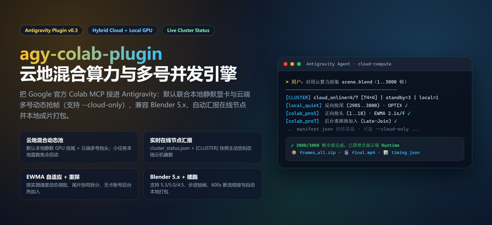
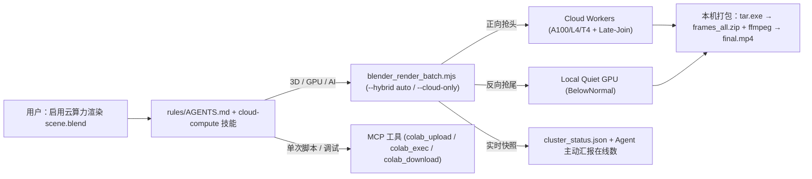

<div align="center">

# agy-colab-plugin — Antigravity × Google Colab 云地混合算力插件

[](plugin.json)
[](tools/colab-mcp-server.mjs)
[](tools/colab_client.mjs)
[](#license)

**把 Google 官方 Colab MCP 接进 Antigravity：默认云地混合动态算力池（支持 `--cloud-only`） · Blender 5.x/4.x Cycles 自适应分片与断点续跑 · 实时在线集群汇报 · 本地自动打包**

<br/>



</div>

---

## ✨ v0.3 核心升级

- **默认云地混合动态算力池（`--hybrid auto`）+ 可选仅云端（`--cloud-only`）**：
  - 自动探测本机 Blender，**小任务（`<= 60` 帧）直走本地静默模式**（免去云端冷启动等待）；
  - **大任务（`> 60` 帧）默认开启「本地静默 GPU 反向抢尾 + 云端多账号正向抢头」双向并发**；
  - 若不想占用自己电脑，可随时显式传入 `--cloud-only`（或对 Agent 说「仅用云端渲染」）。
- **实时在线机器状态汇报（`cluster_status.json` + `[CLUSTER]` 快照）**：
  - 运行期间每次节点状态变化实时打印 `[CLUSTER] cloud_online=X/Y [...] | standby=... | offline=... | local=... | pending=...`；
  - 规则层强制 Agent **不等用户询问**就主动汇报当前几台云端 GPU 在线、拿到什么机型、几台在后台重探。
- **4 项动态算力调度策略**：
  1. **EWMA 自适应调批 + 尾片协同拆分**：根据各节点实测单帧耗时动态调节下批帧数（目标 `~55s`/批），剩余尾片按在线数均分防止长尾拖慢；
  2. **Blender 5.x/4.x 自动兼容 + 像素级参数对齐**：自动拉取 `Blender 5.3 / 5.0 / 4.5 / 4.2`，本地与云端共用同一套 `blender_inner_render.py`（`OPTIX → CUDA → CPU`、`use_persistent_data=True`）；
  3. **自动探卡 + 后台 Late-Join 热加入**：`--spec auto` 按 `A100 → L4 → T4_HIGHMEM → T4` 择优；首轮无卡账号每隔 `~150s` 低频重探，释放出 GPU 即热加入；
  4. **错峰起步 + 断流续接 + 外部贴图打包**：错峰 `create_runtime`、6 次 `executionId` 断流续接、3 次上传重试、支持 `--step` 抽帧与 `--auto-pack` 自动内嵌外部贴图。

---

## 🏗️ 云地混合并发与实时状态架构




---

## 🛠️ 提供的 9 个 MCP 工具

| 工具名 | 作用 | 典型用途 |
| :--- | :--- | :--- |
| `colab_specs` | 查询当前账号可用机型与资格 | 核验 `T4` / `L4` / `A100` / `TPU` / `CPU` 是否 `eligible` |
| `colab_subscription` | 查询订阅档位 | 查看 `free` / `pro` / `pro+` |
| `colab_ensure_runtime` | 创建或复用 25 分钟内保留运行时 | 先锁机器再分步上传、多轮执行、下载 |
| `colab_exec` | 在云端执行 Python 代码 | 跑 GPU 探测、PyTorch 推理、临时计算 |
| `colab_run_script` | 读取本地 `.py` 文件提交执行 | 跑 `tools/blender_job.py` 等完整脚本 |
| `colab_upload` | 上传本地文件到云端容器 | 传 `.blend`、数据集、压缩包（`> 4 MiB` 自动分片） |
| `colab_download` | 从云端容器拉回产物到本地 | 流式下载 `.zip`、`.mp4`、`.png`、`csv` |
| `colab_list` | 列出运行中的 runtime | 巡检各账号是否有残留占额实例 |
| `colab_delete` | 按名称销毁指定 runtime | 释放会话、文件与配额 |

---

## 🚀 快速安装与配置

### 1. 前置准备（Google Cloud 一次性授权）
确保本机已安装 **Node.js 20+**、**Google Cloud SDK (`gcloud`)**，并按 [AGENT.md](AGENT.md) 完成一次 OAuth 授权与项目启用：

```powershell
gcloud auth application-default login --launch-browser `
  --scopes="https://www.googleapis.com/auth/colaboratory,https://www.googleapis.com/auth/cloud-platform,openid,https://www.googleapis.com/auth/userinfo.email"

gcloud projects create <YOUR_PROJECT_ID> --name="colabkit"
gcloud services enable colaboratory.googleapis.com --project=<YOUR_PROJECT_ID>
gcloud auth application-default set-quota-project <YOUR_PROJECT_ID>
gcloud projects add-iam-policy-binding <YOUR_PROJECT_ID> `
  --member="user:<YOUR_EMAIL>" --role="roles/serviceusage.serviceUsageConsumer"
```

### 2. 一键安装到 Antigravity

```powershell
git clone https://github.com/holoiallo/agy-colab-plugin.git
cd agy-colab-plugin
.\install.ps1 -ProjectId <YOUR_PROJECT_ID>
```

安装脚本会自动把 `plugin.json`、`assets/`、`rules/`、`skills/` 与 `tools/` 安装到 `%USERPROFILE%\.gemini\config\plugins\colab`，并生成 `mcp_config.json`（已有配置默认跳过不覆盖）。随后**重启 Antigravity** 即可生效。

### 3. 添加多个独立账号（可选）

```powershell
& "$env:USERPROFILE\.gemini\config\plugins\colab\tools\add-account.ps1" -ProfileName pro2
& "$env:USERPROFILE\.gemini\config\plugins\colab\tools\add-account.ps1" -ProfileName pro3
```

---

## 🎬 使用示例

### 方式一：在 Antigravity 中直接用自然语言触发
- **「启用云算力渲染 `D:\projects\hero.blend`，1 到 3000 帧」** → 默认自动采用云地混合池并发，主动汇报在线云机器数并在本地打包。
- **「仅用云端算力渲染 `D:\projects\hero.blend`，不要占我本地显卡」** → 自动走 `--cloud-only` 纯云端并发。
- **「启用云算力，检查所有节点在线与 T4 可用状态」** → 自动巡检全部账号并汇报。

### 方式二：命令行直接调用动态混合调度器

```powershell
# 1) 1 秒预检路由、本机 Blender 与分片策略（不启动渲染）
node tools/blender_render_batch.mjs `
  --blend "D:\path\to\scene.blend" --start 1 --end 3000 --dry-run

# 2) 默认混合算力并发（本地静默 GPU 抢尾 + 云端多号抢头 + 自动打包）
node tools/blender_render_batch.mjs `
  --blend "D:\path\to\scene.blend" --start 1 --end 3000 --fps 24 --auto-pack --out ".\out-3000"

# 3) 仅用云端算力（不占用本机 GPU）
node tools/blender_render_batch.mjs `
  --blend "D:\path\to\scene.blend" --start 1 --end 3000 --cloud-only --out ".\out-3000"

# 4) 稀疏抽帧预览（如每隔 10 帧渲染一张）
node tools/blender_render_batch.mjs `
  --blend "D:\path\to\scene.blend" --start 1 --end 2281 --step 10 --samples 10 --res 960x540 --out ".\out-preview"
```

---

## 📊 什么时候该上云？实测冷启动与算力对照


> 注：在默认 `--hybrid auto` 模式下，总待渲染帧 `<= 60`（可通过 `--cloud-threshold` 调整）时会自动直走本地静默渲染，彻底避免小任务在云端冷启动上浪费时间。

---

## 🧰 附带 AI / 渲染 Notebook 资产（`cells/` & `notebooks/`）

| 模块 | 产物 | 显存需求 | 说明 |
| :--- | :--- | :--- | :--- |
| `00_env.py` | 环境体检报告 | — | 挂载 Drive、缓存 `HF_HOME`、安装基础依赖 |
| `10_video_wan.py` | `.mp4` | T4 可跑 | Wan2.1-T2V-1.3B 文生视频（draft / standard / quality） |
| `20_music.py` | `.wav` | T4 可跑 | MusicGen 配乐与氛围音效生成 |
| `30_tts.py` | `.mp3` + `.srt` | CPU 即可 | edge-tts 中文旁白与逐词字幕时间轴 |
| `40_asr.py` | `.srt` + `.txt` | T4 可跑 | faster-whisper large-v3 音视频转写 |
| `50_blender.py` | `.png` / `.mp4` | T4 可跑 | Blender Cycles 无头渲染与 Drive 缓存 |
| `85_checkpoint.py` | `tasks.jsonl` | — | 断线重连断点续跑记录 |
| `90_push.py` | `.zip` | — | 扫描全部产物并打包出清单 |

---

## 📁 目录结构

```text
agy-colab-plugin/
├── plugin.json                     # Antigravity 插件清单
├── mcp_config.example.json         # MCP 多账号配置模板（脱敏）
├── install.ps1                     # Windows 一键安装脚本
├── AGENT.md                        # Google Colab MCP 授权与接入指南
├── assets/
│   └── logo.svg                    # 插件矢量图标
├── docs/
│   └── images/                     # README 架构图与算力对照配图
├── rules/
│   └── AGENTS.md                   # 常驻泛化语言触发与状态汇报规则
├── skills/
│   └── cloud-compute/SKILL.md      # 云地混合算力自动调度技能
├── tools/
│   ├── colab_client.mjs            # 共享 MCP JSON-RPC + connectionInfo 传输层
│   ├── colab-mcp-server.mjs        # Antigravity stdio MCP 服务端（9 工具）
│   ├── blender_inner_render.py     # 本地与云端共用的 Cycles 渲染内核
│   ├── blender_chunk_worker.py     # 云端 Blender 5.x/4.x 分片 Worker
│   ├── blender_render_batch.mjs    # 动态混合算力并发总控 + 本地打包器
│   ├── add-account.ps1             # 多账号独立目录隔离授权助手
│   ├── colab_mcp.mjs               # 命令行 MCP 客户端
│   ├── colab.ps1                   # Windows 令牌刷新包装器
│   ├── blender_job.py              # 单帧 Blender Cycles 冒烟脚本
│   └── colab-mcp-selftest.mjs      # MCP 服务自测脚本
├── cells/                          # Colab Notebook Python 源码
└── notebooks/                      # 可直接导入 Colab 的 .ipynb 笔记本
```

---

## License

MIT
